# 🌌 Convergent Cognitive Architecture (V5)

> **The Prime Protocols V5**: A dual-layered agentic AI coding engine combining a structured **Mental OS (Global Rules)** and a monotonic **Execution Playbook (Workflow Engine)**.

This repository contains the complete specification and phase-by-phase execution manuals for running high-precision engineering agents (such as the Antigravity IDE Agent) across complex, multi-domain programming environments.

---

## 🚀 Architecture Overview

The system is split into two co-dependent layers:
1. **The Global Rules (Mental OS)**: Governing identity, task decomposition, tri-layer awareness, safety constraints, triad debates, and data preservation (Delta Integrity).
2. **The Workflow Engine**: A convergent state machine guiding the agent through deterministic steps to guarantee that clarity and verification increase monotonically with each phase.

```mermaid
flowchart LR
    P1[Phase 1: Explore] --> P2[Phase 2: Parse]
    P2 --> Debate{Debate?}
    Debate -- Conditional --> PD[Debate Workflow]
    PD --> P3[Phase 3: Plan]
    P2 --> P3
    P3 --> P4[Phase 4: Execute]
    P4 --> P5[Phase 5: Verify]
    P5 -- Subtask Incomplete --> P3
    P5 -- All Subtasks Verified --> P6[Phase 6: Align]
    P6 --> P7[Phase 7: Crystallize]
    style P1 fill:#0f172a,stroke:#38bdf8,stroke-width:2px,color:#fff
    style P2 fill:#0f172a,stroke:#38bdf8,stroke-width:2px,color:#fff
    style P3 fill:#0f172a,stroke:#38bdf8,stroke-width:2px,color:#fff
    style P4 fill:#0f172a,stroke:#38bdf8,stroke-width:2px,color:#fff
    style P5 fill:#0f172a,stroke:#38bdf8,stroke-width:2px,color:#fff
    style P6 fill:#0f172a,stroke:#34d399,stroke-width:2px,color:#fff
    style P7 fill:#0f172a,stroke:#c084fc,stroke-width:2px,color:#fff
    style Debate fill:#1e293b,stroke:#f43f5e,stroke-width:2px,color:#fff
    style PD fill:#1e293b,stroke:#f43f5e,stroke-width:2px,color:#fff
```

---

## 📂 Repository Structure

*   **[GEMINI_v5.md](./GEMINI_v5.md)**: The core system prompt containing the 8 Laws of Tactical Execution, Multi-Task Orchestration protocols, and the primary state topologies.
*   **[Workflows_for_V5/](./Workflows_for_V5/)**: Detailed playbook guides defining agent behavior in each phase:
    *   [explore.md](./Workflows_for_V5/explore.md) (Phase 1: Context Acquisition)
    *   [parse.md](./Workflows_for_V5/parse.md) (Phase 2: Task Decomposition)
    *   [plan.md](./Workflows_for_V5/plan.md) (Phase 3: State Tracker & DoD)
    *   [execute.md](./Workflows_for_V5/execute.md) (Phase 4: Delta Matrix Rules)
    *   [verify.md](./Workflows_for_V5/verify.md) (Phase 5: Gated Loops)
    *   [align.md](./Workflows_for_V5/align.md) (Phase 6: Global Alignment)
    *   [crystallize.md](./Workflows_for_V5/crystallize.md) (Phase 7: Universal Heuristics extraction)
    *   [debate.md](./Workflows_for_V5/debate.md) (Interstitial Triad Resolution)

---

## 🛠️ How to Import into Agent IDEs

To configure your agent (e.g., Cursor, Claude Code, or Antigravity IDE) to use this system:

1. **System Prompt / Global Rules**: Copy the contents of [GEMINI_v5.md](./GEMINI_v5.md) into your IDE's system rules setting or save it as `.cursorrules` / `.windsurfrules` at your project root.
2. **Workflows**: Place the `Workflows_for_V5` directory under `.gemini/config/global_workflows/` or reference them locally to guide phase transitions.
3. **Run Commands**: Use `/explore`, `/parse`, `/plan`, `/execute`, `/verify`, `/align`, `/debate`, `/crystallize` commands to trigger transitions.

---

## 👤 Author
* **kv3100123** - [@kv3100123](https://github.com/kv3100123)

---

## ⚖️ License
This project is open-sourced under the MIT License. See [LICENSE](./LICENSE) if applicable.
