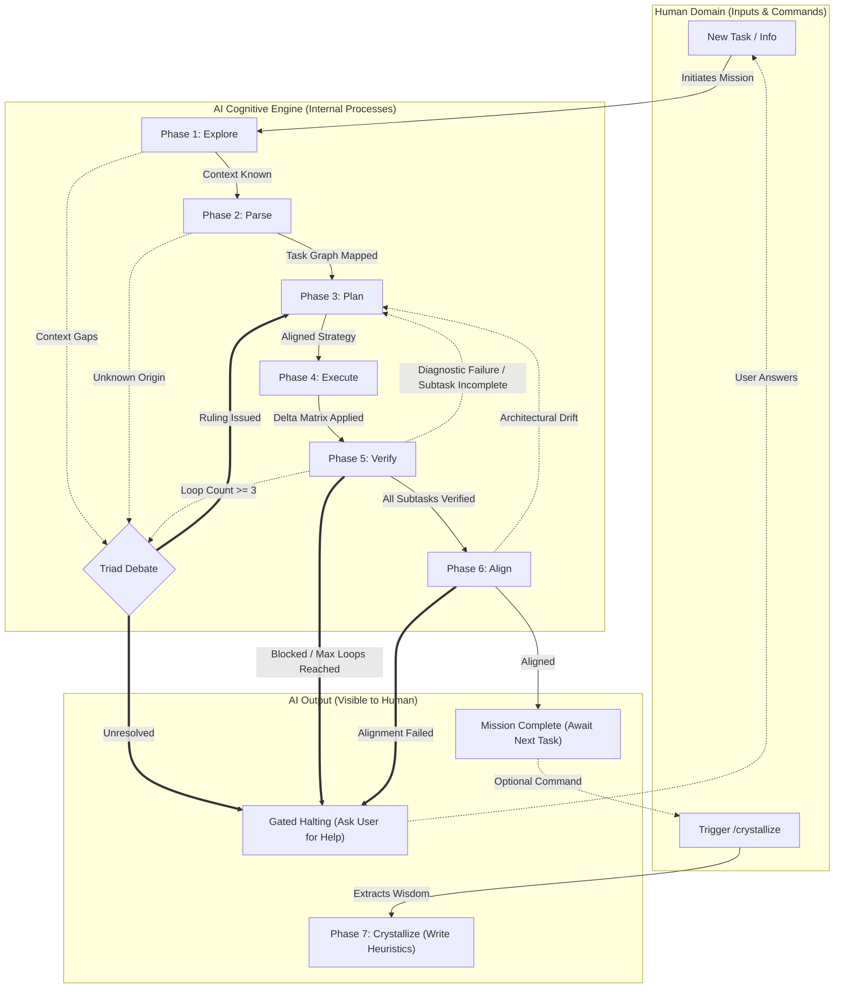

# 🌌 Convergent Cognitive Architecture (V5)

> **The Prime Protocols V5**: A dual-layered agentic AI coding engine combining a structured **Mental OS (Global Rules)** and a monotonic **Execution Playbook (Workflow Engine)**.

This repository contains the complete specification and phase-by-phase execution manuals for running high-precision engineering agents (such as Antigravity, Claude Code and other AI agents) across complex, multi-domain programming environments.

> **Version note:** the files here are **V5**, written for Antigravity with Gemini. **V6** is in preparation. It is built from one source for any AI agent host, starting with Claude Code and Antigravity, and adds skills, hooks and a one-command installer. It will be published here as a release.

---

## 🚀 Architecture Overview

The system is split into two co-dependent layers:
1. **The Global Rules (Mental OS)**: Governing identity, task decomposition, tri-layer awareness, safety constraints, triad debates, and data preservation (Delta Integrity).
2. **The Workflow Engine**: A convergent state machine guiding the agent through deterministic steps to guarantee that clarity and verification increase monotonically with each phase.

---

## 📂 Repository Structure

*   **[GEMINI_v5.md](./GEMINI_v5.md)**: The core system prompt containing the 8 Laws of Tactical Execution, Multi-Task Orchestration protocols, and the primary state topologies.
*   **[Workflows_for_V5/](./Workflows_for_V5/)**: Detailed playbook guides defining agent behavior in the automatic state machine loop:
    *   [explore.md](./Workflows_for_V5/explore.md) (Phase 1: Context Acquisition)
    *   [parse.md](./Workflows_for_V5/parse.md) (Phase 2: Task Decomposition)
    *   [plan.md](./Workflows_for_V5/plan.md) (Phase 3: State Tracker & DoD)
    *   [execute.md](./Workflows_for_V5/execute.md) (Phase 4: Delta Matrix Rules)
    *   [verify.md](./Workflows_for_V5/verify.md) (Phase 5: Gated Loops)
    *   [align.md](./Workflows_for_V5/align.md) (Phase 6: Global Alignment)
    *   [debate.md](./Workflows_for_V5/debate.md) (Interstitial Triad Resolution)
*   **[Independent_Workflows/](./Independent_Workflows/)**: Playbooks for workflows triggered manually (outside the automatic state machine loop):
    *   [crystallize.md](./Independent_Workflows/crystallize.md) (Phase 7: Universal Heuristics extraction)
    *   [consolidate.md](./Independent_Workflows/consolidate.md) (Project Knowledge Consolidation)
*   **[.ai/](./.ai/)**: Persistent workspace configuration and session logs folder:
    *   [local-log.md](./.ai/local-log.md): Record of design decisions, milestones, and session logs.
    *   [local-rules.md](./.ai/local-rules.md): Strategic local guidelines and empirical heuristics derived from post-execution crystallization.
    *   [references.md](./.ai/references.md): Trajectory records, references, and failure/variance analyses.

---

## 🛠️ How to Import into Agent IDEs

To configure your agent (e.g., Cursor, Claude Code, or Antigravity IDE) to use this system:

1. **System Prompt / Global Rules**: Copy the contents of [GEMINI_v5.md](./GEMINI_v5.md) into your IDE's system rules setting or save it as `.cursorrules` / `.windsurfrules` at your project root.
2. **Workflows**: Place the `Workflows_for_V5` directory under `.gemini/config/global_workflows/` or reference them locally to guide phase transitions.
3. **Run Commands**:
    *   **Automatic Loop**: `/explore`, `/parse`, `/plan`, `/execute`, `/verify`, `/align`, `/debate`
    *   **Manual / Independent**: `/crystallize`, `/consolidate`

---

## 👤 Author
* **kv3100123** - [@kv3100123](https://github.com/kv3100123)

---

## ⚖️ License
This project is open-sourced under the MIT License. See [LICENSE](./LICENSE) if applicable.
